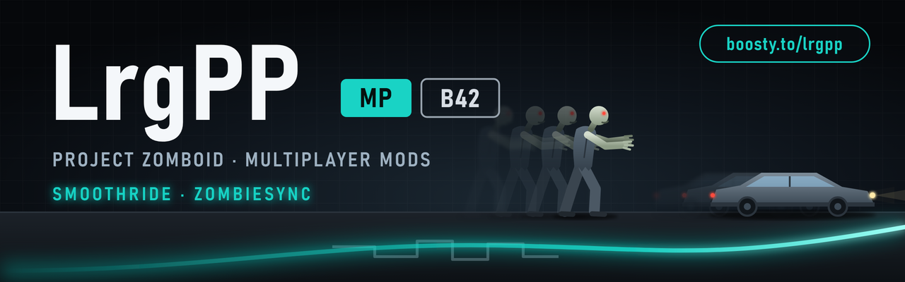
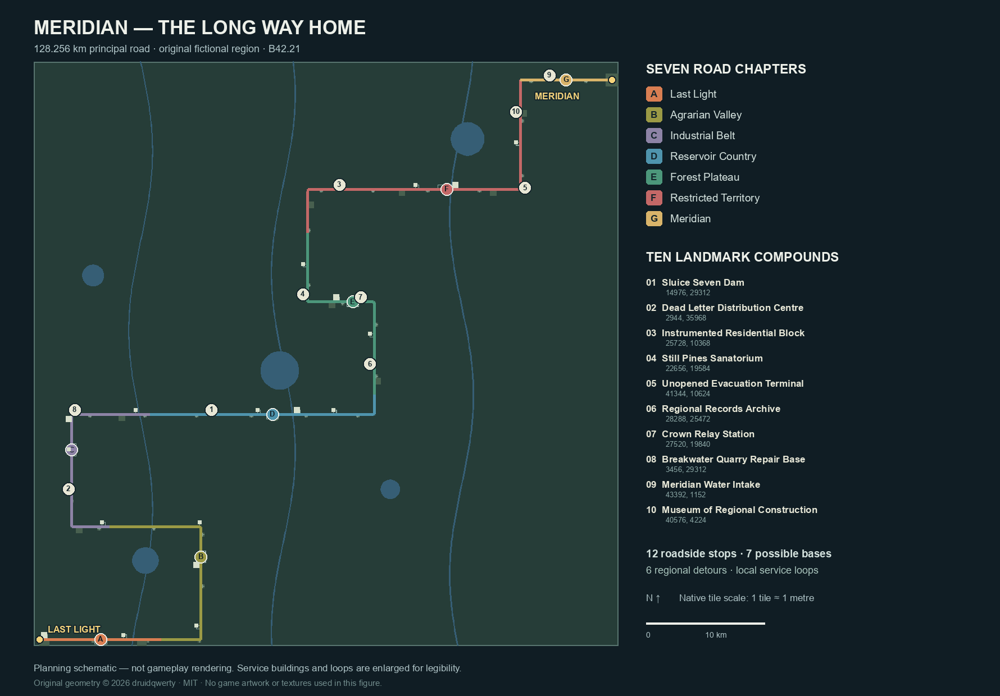

# Meridian: The Long Way Home — B42.21

Support independent mods / Поддержать разработку модов.

**An original standalone expedition map.** Leave Last Light in the southwest,
follow the supply road through abandoned communities and classified installations,
and reach the walled city of Meridian in the northeast. Its streets are empty of
infected. The two-storey Continuity habitat beneath them is not.

## Test build

**0.2.0-alpha.1 — urban/interior rebuilding.** The old near-identical four-room
stock is replaced by compact homes, L-plan ranches, duplexes, row houses,
garages, guard huts, schools, police/fire stations and mixed-use shopping rows.
Native room switches, powered fixtures and verified furniture facing replace
the former sparse, fixed-facing arrangements. Electricity obeys normal PZ rules.

Meridian now has a high-rise majority: residential towers occupy 9–11 storeys,
office towers 11–13, with real rooms and stairs. Regional skylines build up along
the journey. Four separate large shopping centres have broad marked concrete
parking lots and tiled forecourts; smaller gun shops use native loot categories.
Continuous sidewalks, facade signs and off-lane road signs add everyday detail.
The city wall is 13 tiles deep and eight storeys high, with a crown walkway and
a four-storey-clear gate. See [urban rebuilding](docs/URBANISM.md) and
[realizable references](docs/REALIZABLE_REFERENCES.md).

- 128.256 km principal road; 49.152 × 49.152 km authored journey envelope,
  native scale. Vanilla wilderness continues outside it.
- Six civilian districts, six military/research districts, roadside service stops,
  and the largest, walled final city. The hinterland uses vanilla B42 wilderness.
- Seven route chapters; six local regional bypasses, 28 compound service spurs
  and 25 second exits. The principal journey has not been shortened.
- Ten landmark compounds: dam, postal hub, test homes, sanatorium, evacuation
  terminal, regional archive, relay, quarry repair base, water intake and museum.
- Twelve differentiated roadside stops and seven potential expedition bases.
  [Places and coordinates](docs/EXPEDITION-LOCATIONS.md) are optional spoilers.
- Room-specific furniture and decor: kitchens, bedrooms, wards, classrooms,
  laboratories, offices, storage bays and furnished public halls.
- Salvageable roadside checkpoints and furniture barricades inside/outside
  buildings. Detours remain open; use the normal furniture tools/actions.
- Twelve surface entrances to the main refuge; connected galleries, living quarters,
  medical wards, laboratories and supply caches on floors −1 and −2.
- Additional underground research annexes. Thirteen bilingual archive fragments.
- Metal tunnel doors and salvageable supply barriers; stair landings stay clear.
- Four city districts: civic, residential, utilities and council towers. Sixteen
  underground wings include schools, domestic services, recreation and workshops;
  twelve role-specific entrances, service rings and secondary doors create loops.
- Convoy17's seven-stage trail uses the existing archives and abandoned belongings,
  not a new quest system or scripted vehicle/NPC events.
- Working fuelled starting SUV with a key; actual fuel pumps along the route.
- Native zombie density rises toward the northeast. The city surface is cleared
  independently of its underground infestation, including incoming wanderers.

The route is **about 4.90× a geometric vanilla road-path proxy**. That is not a
verified fivefold driving-time benchmark. Off-road shortcuts remain possible.
This is an alpha for gameplay/art feedback, not a claimed hand-polished final map.
The new pass adds **map content only**: no access cards, radio, power-restoration,
special fuel/repair rules, mandatory quests or victory-screen system.
Dam/quarry/relay compounds use native scenery, not working industrial simulation
or new elevated terrain. See [expedition](docs/EXPEDITION.md) and
[habitat](docs/HABITAT.md) for what is actually built.

## Play

1. Extract the ZIP so `Zomboid/mods/MeridianLongWayHome` contains `42` and `common`.
2. Enable **Meridian: The Long Way Home** in Mods.
3. Start a **new Sandbox world**, select the **Meridian** map/start region.
4. Spawn in Last Light. The SUV is on the nearby main road at (640, 48640).
   Follow the road east. Fuel stops are roughly 4.5 km apart.
5. Right-click near district archives to read the recovered records. Look for
   hidden metal lockers in ordinary buildings and sealed underground stores.
6. Remove window planks with a crowbar. For furniture and checkpoint objects,
   use the normal furniture **Disassemble / Pick up** modes with the required
   tools and skills. The main road always retains a five-tile passage.

Optional spoiler: [archive location guide](docs/ARCHIVES.md).
Cannot find the bunker? [Entrance map and directions](docs/BUNKER-ACCESS.md).
From the west gate, head east to X48256, then north to the pavilion's south door
at X48259,Y1424. The actual stair is at X48255,Y1408. There are twelve entrances.

Do not add this map to an existing save or mix it with another map replacing the
same cells. Existing saves are not migrated. Normal sandbox zombie population
settings still apply; disabling all zombies also disables custom bunker hordes.

## Viewpoint

Optional, **not a required dependency**. Install Viewpoint and its ZombieBuddy
dependency separately; their files are not included. Target: Viewpoint 0.1.6.1 /
PZ 42.21. No replacement camera or custom depth textures are used. See
[QA evidence and limits](docs/QA.md) for the actual tested modes and remaining
limitations. Multiplayer is not yet certified.
Known visual limitation: Viewpoint can draw bands of the overlying terrain texture
along underground ceiling edges. Native rooms/ceilings exist; this is not a claim
of a uniformly polished first-person ceiling in every hall.

## Development

Python 3.10+; `pip install -r requirements.txt`, then `python tools/generate.py`.
Run `python tools/audit.py` against the installed game and `python -m unittest
discover -s tests -v` (tests also need `requirements-dev.txt`). Generated native maps are distributed as release ZIPs, not
committed game assets. Read [MODLOG](https://github.com/druidqwerty/pz-meridian/blob/main/MODLOG.md), [architecture](docs/ARCHITECTURE.md)
and [runtime](RUNTIME.md). Created with AI assistance. Original geometry and code;
no Real USA building or third-party mod asset was copied.

GitHub-only prerelease. No Steam or Boosty publication is authorized for this map.

## Русский

**Новая карта-путешествие, не Россия и не копия реальной местности.** Старт —
юго-западный Ласт-Лайт. Дорога ведёт через заброшенные поселения к всё более
закрытым военным объектам и городу Меридиан на северо-востоке.

Наверху, внутри стен, зомби нет. Под городом — два заражённых этажа убежища
«Непрерывность»: тоннели, жильё, лаборатории и склады. По документам эвакуация
оказалась частью заранее подготовленного эксперимента; один заражённый разрушил
план идеальной безопасности. Дополнительные тайные комплексы скрыты по маршруту.

Установка: включить мод и начать **новую игру Sandbox на карте Meridian**.
Внедорожник с ключом и полным баком ждёт у стартового посёлка на главной дороге.
Далее — топливные станции примерно через 4,5 км. Документы открываются правой
кнопкой рядом с архивами районов. Мебель и лут соответствуют назначению комнат.
В зданиях стало больше мебели и декора; на дорогах, внутри и снаружи зданий —
разбираемые заграждения. В тоннелях — металлические двери и завалы из припасов.
Для разборки и переноса используются обычные игровые инструменты и действия.
Оконные доски снимаются ломом; мебель и дорожные ограждения — через режимы
**«Разобрать / Поднять»** с нужными инструментами и навыками. На трассе оставлен
проезд шириной пять тайлов: разборка не обязательна для продолжения путешествия.

Добавлены семь дорожных глав, шесть местных объездов, десять крупных комплексов,
двенадцать разных придорожных остановок и семь возможных экспедиционных баз.
В Meridian различаются четыре городских района; в убежище — шестнадцать
функциональных крыльев с бытовыми, общественными и техническими помещениями.
Двенадцать входов ведут в разные сектора, служебные кольца дают пути отхода.
Через существующие архивы и следы оставленных вещей проходит история колонны17.

В обновлении 0.2.0-alpha.1 переработаны сами планировки: небольшие дома, ранчо с
двором, дуплексы, гаражи, сторожки, школы, полиция, пожарные станции и торговые
ряды. У мебели проверено направление; добавлены комнатные выключатели и настоящие
светильники. Электричество работает по обычным правилам игры.
К финалу растёт этажность; в Meridian большинство застройки — высотные кварталы,
жилые башни 9–11 этажей и офисные 11–13. У четырёх крупных ТЦ — просторные
размеченные парковки и плиточные площади. Есть небольшие оружейные магазины,
вывески и дорожные знаки; тротуары соединяются через границы клеток карты.
Стена стала объёмной: 13 клеток толщины, 8 этажей высоты и верхний проход.
Вход в бункер: от западных ворот на восток до X48256, затем на север к двери
X48259,Y1424; лестница X48255,Y1408. [Схема](docs/BUNKER-ACCESS.md).

Это **только наполнение карты**, без новых механик: пропусков, радио, запуска
электроснабжения, особого ремонта, квестового журнала или обязательного финала.
Дамба плоская; карьер и ретранслятор — оформленные комплексы, не новые системы.
Координаты мест — в [путеводителе](docs/EXPEDITION-LOCATIONS.md).

Главная дорога — 128 км, примерно в 4,9 раза длиннее расчётного ванильного
автомобильного маршрута. Пятикратное время поездки ещё не замерено. Это тестовая
альфа: баланс, оформление и отдельные маршруты требуют игрового отзыва.
Viewpoint необязателен; результаты проверки — в QA. Существующие сохранения не
трогаются. Публикация пока только на GitHub, без Steam и Boosty.

Copyright © 2026 druidqwerty. Original Meridian code and geometry: MIT.
Project Zomboid artwork and game belong to The Indie Stone; not included.
Авторское право © 2026 druidqwerty. Исходный код и геометрия Meridian: MIT.
Графика и игра Project Zomboid принадлежат The Indie Stone и не включены.
