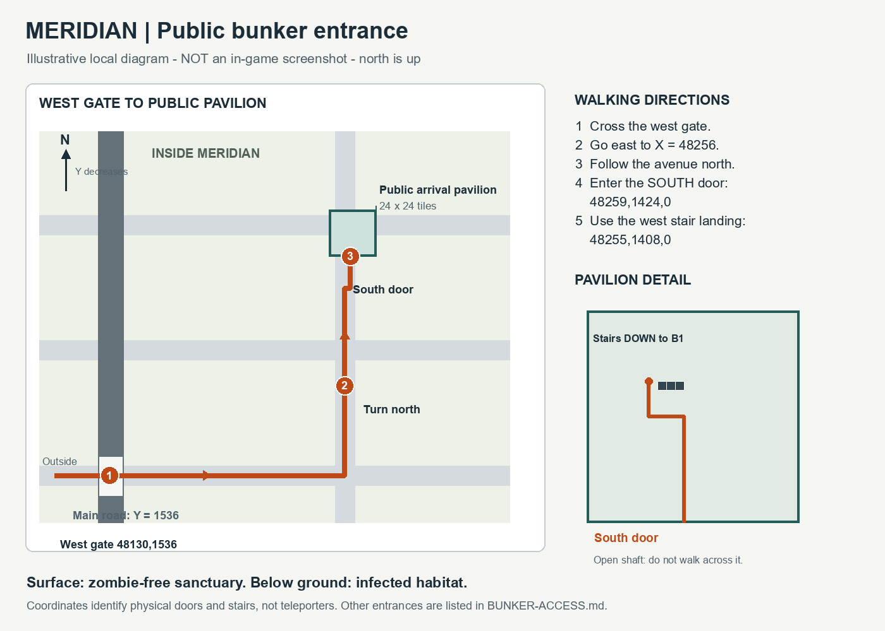

# Bunker access / Как попасть в убежище

## Ближайший общественный вход от западных ворот

Схема выше — **иллюстрация, не игровой скриншот**. Север наверху; на карте
игры с изометрической камерой направления экрана другие. Север = уменьшение Y.

1. Пройди западные ворота Meridian: **48130,1536,0**.
2. Иди на восток по главной улице до **48256,1536,0**.
3. Поверни на север по улице X=48256 к отдельному квадратному павильону.
4. Зайди через южную дверь **48259,1424,0**.
5. Внутри подойди к западной верхней площадке лестницы: **48255,1408,0**.
6. Спустись по настоящей лестнице. Нижний подход: **48259,1408,-1**.

Поверхность Meridian безопасна от зомби; подземные этажи заражены.
Для следующей лестницы B1→B2 верхняя площадка здесь **48255,1416,-1**,
нижний подход — **48259,1416,-2**. Это обычные лестницы, не телепорты.

## Public entrance from the west gate

The diagram is illustrative, **not a game screenshot**. North means decreasing Y.
Cross the west gate at **48130,1536,0**; follow the principal road east to
**48256,1536,0**, then turn north. Enter the pavilion through its south door
at **48259,1424,0**. Its west upper stair landing is **48255,1408,0**;
the lower approach is **48259,1408,-1**. The deeper flight has its upper
landing at **48255,1416,-1** and lower approach at **48259,1416,-2**.

## All twelve main entrances / Все двенадцать основных входов

Door = outside south-door square; landing = upper stair approach. All door
and upper-landing coordinates below are z=0. Every bottom approach is z=-1.
Дверь — южный вход снаружи; площадка — верхний подход к лестнице.

| Entrance / Вход | South door / Южная дверь | Upper landing / Верхняя площадка | B1 bottom / Нижний подход |
|---|---|---|---|
| Medical reception / Приём пациентов | 48259,1168 | 48255,1152 | 48259,1152 |
| Hospital staff entrance / Вход персонала госпиталя | 48515,1168 | 48511,1152 | 48515,1152 |
| Research entrance / Исследовательский вход | 48771,1168 | 48767,1152 | 48771,1152 |
| Isolation emergency exit / Аварийный выход изолятора | 49027,1168 | 49023,1152 | 49027,1152 |
| Public arrival hall / Общественный приёмный зал | 48259,1424 | 48255,1408 | 48259,1408 |
| Water-service entrance / Вход водоснабжения | 49027,1424 | 49023,1408 | 49027,1408 |
| Cargo receiving entrance / Грузовой приёмный вход | 48259,1680 | 48255,1664 | 48259,1664 |
| Power-service entrance / Вход энергослужбы | 49027,1680 | 49023,1664 | 49027,1664 |
| Repair-crew entrance / Вход ремонтных бригад | 48259,1936 | 48255,1920 | 48259,1920 |
| Records and administration / Архив и управление | 48515,1936 | 48511,1920 | 48515,1920 |
| Communications entrance / Вход центра связи | 48771,1936 | 48767,1920 | 48771,1920 |
| Reserve evacuation exit / Резервный эвакуационный выход | 49027,1936 | 49023,1920 | 49027,1920 |

Three separate research annexes outside Meridian are not included in this main-city
table. They are independent infected complexes, not shortcuts into the final city.
Три отдельные исследовательские пристройки за пределами Meridian в таблицу не
включены: они не являются коротким путём внутрь финального города.

Coordinates are read from the generated manifest and fixed native pavilion geometry.
A guide is not live-game proof: current QA status remains in [QA.md](QA.md).
